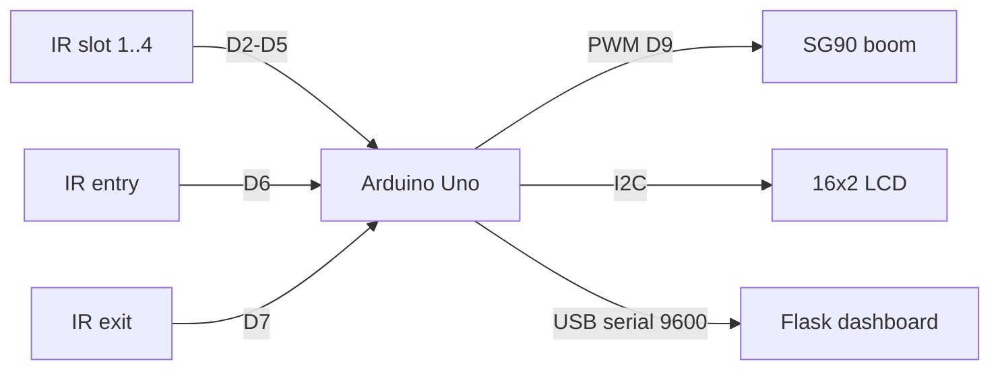
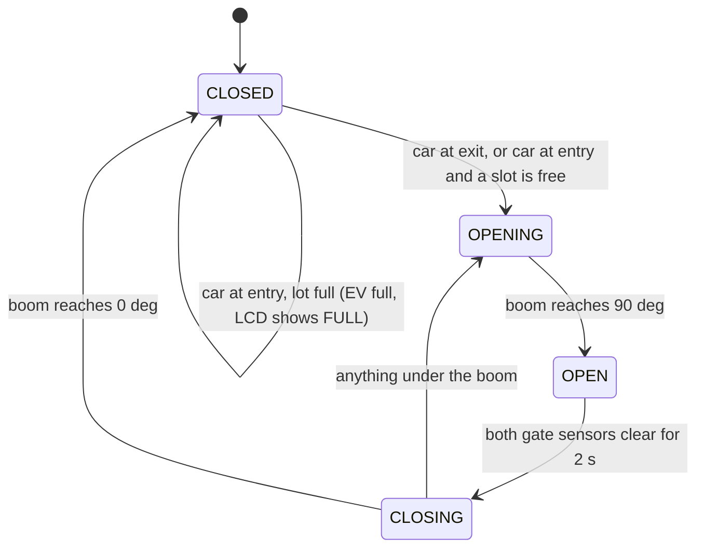

# smart-car-parking

Parking lot controller for an Arduino Uno. IR sensors tell which of the 4
slots are taken, a servo works as the entry boom, and a 16x2 LCD at the
entrance shows how many slots are free. When the lot is full the gate stays
closed and the LCD says so. The Uno prints a status line on serial every time
something changes, and a small Flask page on the PC shows the lot live.

This is a rebuilt and cleaned up version of my B.Tech project at Anurag
Group of Institutions (now Anurag University). The original sketch used
`delay()` everywhere and the slot count jumped around when a car was half in
a slot. This version has proper debouncing and a non-blocking gate state
machine, and all of that logic is plain C that is unit tested on a PC. There
is also a simulator, so everything except the Arduino glue can be run without
hardware. I don't have photos of the original build, so none are included.

## Block diagram



## Gate state machine



The boom moves at about 6 ms per degree instead of jumping straight to the
end position. Snapping an SG90 from 0 to 90 draws enough current to reset
the Uno when everything runs off USB.

## Hardware

- Arduino Uno (any ATmega328P board works)
- 6 x FC-51 IR obstacle sensor modules (4 slots, entry, exit)
- SG90 micro servo for the boom
- 16x2 LCD with PCF8574 I2C backpack
- Separate 5 V supply for the servo is recommended

## Wiring

| Part           | Pin       | Uno pin | Notes                         |
|----------------|-----------|---------|-------------------------------|
| IR slot 1      | OUT       | D2      | active low                    |
| IR slot 2      | OUT       | D3      |                               |
| IR slot 3      | OUT       | D4      |                               |
| IR slot 4      | OUT       | D5      |                               |
| IR entry       | OUT       | D6      |                               |
| IR exit        | OUT       | D7      |                               |
| SG90           | signal    | D9      | servo + to 5 V supply         |
| LCD backpack   | SDA / SCL | A4 / A5 | address 0x27 (some are 0x3F)  |
| All modules    | VCC / GND | 5V / GND| common ground with servo supply |

## Repo layout

```
lib/parking_core/   plain C: debounce, slot count, gate state machine
src/main.cpp        Uno firmware (Arduino framework, PlatformIO)
host/parking_sim.c  runs parking_core on a PC from an input script
host_tests/         C unit tests
scenarios/          input scripts for the simulator
tools/sim_cars.py   random traffic generator that drives parking_sim
dashboard/          Flask page (reads serial or the simulator)
tests/              pytest tests
```

## Serial protocol

9600 baud, one line per change:

```
ST slots=1010 free=2 gate=OPEN
EV full
```

`slots` is slot 1..4 left to right, 1 = car present. Lines starting with `#`
are comments (boot message).

## Build and flash

```
pip install platformio
pio run
pio run -t upload
pio device monitor -b 9600
```

Compile output (no board connected):

```
RAM:   [===       ]  31.3% (used 641 bytes from 2048 bytes)
Flash: [===       ]  27.5% (used 8884 bytes from 32256 bytes)
```

## Tests

```
$ make test
cc -std=c99 -Wall -Wextra -Werror -O1 -g -Ilib/parking_core host_tests/test_parking.c lib/parking_core/parking.c -o build/test_parking
cc -std=c99 -Wall -Wextra -Werror -O1 -g -Ilib/parking_core host/parking_sim.c lib/parking_core/parking.c -o build/parking_sim
./build/test_parking
29 checks, 0 failed

$ pip install -r requirements.txt
$ python3 -m pytest -q tests
........                                                                 [100%]
8 passed in 0.14s
```

The C tests cover debounce (glitches ignored, `millis()` wrap), slot count,
a full open/hold/close cycle, the "lot full" case, exit opening even when
full, and the boom going back up if a car rolls under it while closing.

## Simulator

`parking_sim` runs the same C code as the Uno, stepping it every 10 ms.
Input lines are `<time ms> <slots> <entry> <exit>`. The `-t` flag adds the
simulated time to each output line.

```
$ ./build/parking_sim -t < scenarios/full_lot.txt
[      0] ST slots=0000 free=4 gate=CLOSED
[    160] ST slots=1111 free=0 gate=CLOSED
[   2160] EV full
[   2160] ST slots=1111 free=0 gate=CLOSED
[   7160] ST slots=1101 free=1 gate=OPENING
[   7700] ST slots=1101 free=1 gate=OPEN
[  11650] ST slots=1101 free=1 gate=CLOSING
[  12190] ST slots=1101 free=1 gate=CLOSED
[  14160] ST slots=1111 free=0 gate=CLOSED
```

The 160 ms delays are the 150 ms debounce plus one 10 ms loop.

Random traffic:

```
$ python3 tools/sim_cars.py --cars 10 --seed 3
...
ST slots=1101 free=1 gate=CLOSED
ST slots=1111 free=0 gate=CLOSED
EV full
ST slots=1111 free=0 gate=CLOSED
ST slots=1110 free=1 gate=CLOSED
ST slots=1110 free=1 gate=OPENING
...
```

## Dashboard

```
python3 dashboard/app.py --sim                    # simulated traffic
python3 dashboard/app.py --serial /dev/ttyUSB0    # real Uno (COM3 on Windows)
```

Open http://localhost:5000. The page refreshes every second and shows each
slot, the gate state, how many cars were turned away, and the last serial
lines. `/api/status` returns the same thing as JSON:

```
$ curl -s localhost:5000/api/status
{"free": 4, "full_count": 0, "gate": "CLOSED", "log": ["04:50:21  ST slots=0000 free=4 gate=CLOSED", "04:50:21  ST slots=0000 free=4 gate=CLOSING", ...], "slots": [false, false, false, false], "updated": 1793249421.34}
```

## Known limitations

- FC-51 modules are reflective IR. Dark cars and sunlight both cause
  missed or false detections. The debounce helps with flicker, not with that.
- A car is counted as "in a slot" only by the slot sensor. A car that enters
  and stays in the driveway isn't counted, so the gate can let in one more car
  than there are free slots.
- The safety reverse while closing uses the raw sensor value (no debounce),
  because waiting 150 ms let the boom drop another ~25 deg. The downside is
  that a single noisy read can make the boom go back up.
- No persistence: after a reset the slot state is rebuilt from the sensors,
  which is fine, but the "turned away" count on the dashboard starts at 0.
- Firmware is compile-checked in CI only. The C logic is tested, the
  Arduino glue (pin reads, LCD, servo) needs the real board.

## Things I'd do differently

- Use ultrasonic or magnetic (QMC5883-type) sensors in the slots instead of
  reflective IR.
- Use two sensors at the gate to know direction, so the lot can keep an
  actual car count instead of trusting the slot sensors only.
- Send status over MQTT from an ESP32 instead of USB serial, so the
  dashboard doesn't need a cable to the controller.
- Use a websocket or server-sent events instead of a 1 s page refresh.

## License

MIT
